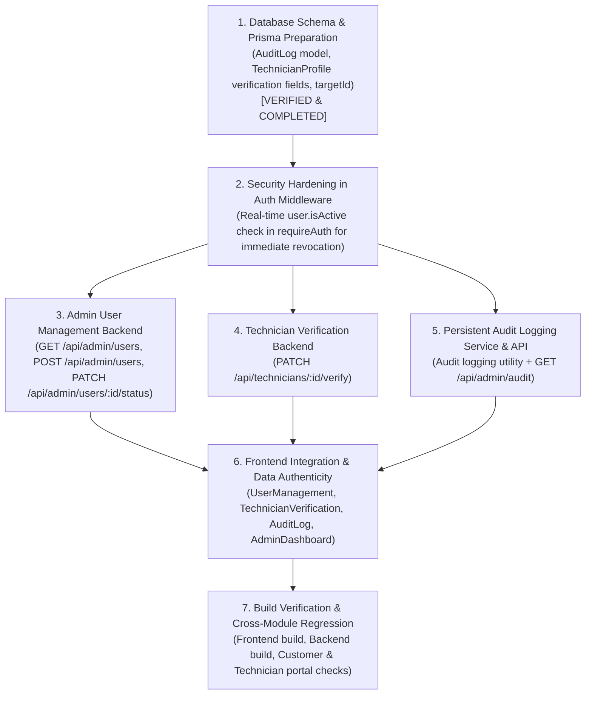

# VOLTOPS — ADMIN COMPLETION & BACKEND INTEGRATION AUDIT
**Milestone:** 2.1 — Admin Module Completion, Backend Integration & Security Hardening  
**Auditor:** Senior Full-Stack, Database Architect & Application Security Engineer (Pranta's Lead Team)  
**Date:** 11 November 2026  
**Repositories Inspected:**
- Frontend: `VoltOps-Frontend` (`e:\BUBT-CSE-4th yr\SDP-4\VoltOps\voltops-frontend\voltops-frontend`) on branch `pranta`
- Backend: `voltops-backend` (`E:\BUBT-CSE-4th yr\SDP-4\VoltOps\voltops-backend\voltops-backend`) on branch `pranta`

---

## 1. Executive Summary & Verification of Previous Reports

Every statement from previous engineering documentation was verified against actual repository source code:

1. **Backend Route Mounting (`voltops-backend/src/routes/index.ts`)**:
   - Only `/api/auth` and `/api/technicians` are currently mounted.
   - `/api/admin` does not exist in routes.
2. **Technician Endpoint (`voltops-backend/src/routes/technicianRoutes.ts`)**:
   - `GET /api/technicians` exists and is guarded by `requireAuth` + `authorize("ADMIN", "DISPATCHER")`.
   - `PATCH /api/technicians/:id/verify` is **NOT** implemented in the backend.
3. **User Management Endpoints**:
   - Neither `GET /api/admin/users`, `POST /api/admin/users`, nor `PATCH /api/admin/users/:id/status` exist in the backend.
4. **Database Schema (`voltops-backend/prisma/schema.prisma`)**:
   - **Schema Status**: Updated and validated (`npx prisma validate` passes cleanly).
   - Enums added: `VerificationStatus` (`VERIFIED`, `PENDING_REVIEW`, `REJECTED`), `AuditCategory` (`AUTH`, `ROLE_CHANGE`, `DISPATCH`, `VERIFICATION`, `SECURITY`, `ACCOUNT`), `AuditSeverity` (`INFO`, `WARNING`, `CRITICAL`).
   - Models added: `AuditLog` (with `actorId`, `actorName`, `actorRole`, `actorIp`, `category`, `action`, `targetEntity`, `targetId`, `severity`, `details`, `timestamp`, indexes).
   - Models updated: `TechnicianProfile` with passport verification fields (`verificationStatus` default `PENDING_REVIEW`, `verifiedAt`, `verifiedBy`, `verificationNotes`, `licenseNumber`, `issuingAuthority`, `licenseExpiryDate`).
   - Backward Compatibility: All added fields are either nullable or have safe defaults, guaranteeing zero breakages for existing User/Technician records, seed scripts, and authentication.
5. **Database Migration State**:
   - `prisma/migrations` does not exist in Git history (neither on `main` nor on `pranta`).
   - Local system probe confirmed no active PostgreSQL server running on `127.0.0.1:5432`.
   - No `.env` file exists in `voltops-backend` on disk (only `.env.example`).
   - In accordance with safety rules, no destructive migrations or untested migrations against unverified databases were run.
   - Schema validation and Prisma Client generation (`v5.22.0`) succeeded with 0 errors.
6. **Session Revocation Gap (SEC-02)**:
   - `src/middleware/auth.ts` currently verifies JWTs cryptographically with `verifyToken(token)` without checking `user.isActive` against PostgreSQL. Deactivated users retain access until the 7-day token expires.
7. **Dashboard Metrics Authenticity**:
   - Frontend `AdminDashboard.tsx` previously showed `99.2% SLA Compliance` and `34 total users` as simulated constants. These must be replaced with real backend telemetry or honest development/unavailable state indicators.

---

## 2. Implementation Gap Matrix

| Feature | Existing Frontend | Existing Backend | Database Support | Remaining Work | Risk & Classification |
|---|---|---|---|---|---|
| **User Directory** | Complete UI with search, role filters, status filters, and pagination | **MISSING** (`GET /api/admin/users` absent) | `model User` exists in Prisma | Implement backend controller, query parsing, pagination, and connect frontend | **BACKEND MISSING** |
| **Staff Account Creation** | Complete UI modal with role selector, branch, validation | **MISSING** (Public register only creates `CUSTOMER`) | `model User` + `TechnicianProfile` | Implement `POST /api/admin/users` with bcrypt hash, transaction for technician profiles | **BACKEND MISSING** |
| **Account Activation / Deactivation** | Complete UI with confirmation dialog | **MISSING** (`PATCH /api/admin/users/:id/status` absent) | `isActive Boolean` on `User` | Implement status toggle endpoint + audit event dispatch | **BACKEND MISSING** |
| **Session Revocation on Deactivation** | Interceptor redirects on 401 | **MISSING** (`requireAuth` does not query `isActive`) | `User.isActive` exists | Update `requireAuth` to verify `user.isActive === true` from DB | **NEEDS SECURITY FIX** |
| **Technician Directory** | Complete UI with trade filters | `GET /api/technicians` implemented | Supported by Prisma relations | Connect real mapping directly to frontend verification view | **COMPLETE (Integration Polish)** |
| **Technician Verification Decisions** | Complete UI modal with audit notes | **MISSING** (`PATCH /api/technicians/:id/verify` absent) | Verification fields ready in Prisma schema | Build controller endpoint, update status, and log audit event | **BACKEND MISSING** |
| **Audit Log Event Persistence** | Complete UI with category/severity filters & JSON export | **MISSING** (`GET /api/admin/audit` absent) | `AuditLog` model ready in Prisma schema | Create logger service utility, build paginated API, and connect frontend | **BACKEND MISSING** |
| **Dashboard Data Authenticity** | Governance layout exists | Partially probes `/api/technicians` | Aggregate queries possible | Replace fake 99.2% SLA with real aggregated DB metrics or honest empty state | **PARTIALLY COMPLETE** |
| **JWT Storage & Cookie Migration** | Uses `localStorage` | Uses Bearer header only; lacks `cookie-parser` | N/A | Add `cookie-parser` or harden Bearer flow with real-time revocation | **NEEDS SECURITY FIX** |

---

## 3. Schema-to-Feature Mapping (Milestone 2.1 Verified)

### A. User Management (`/admin/users`)
- **Frontend View**: `src/pages/admin/UserManagement.tsx`
- **Required Endpoints**:
  - `GET /api/admin/users?role=&status=&search=&page=&limit=`
  - `POST /api/admin/users` (Payload: `{ name, email, password, role, branch?, department?, designation? }`)
  - `PATCH /api/admin/users/:id/status` (Payload: `{ isActive: boolean }`)
- **Prisma Models & Fields**:
  - `User.id`, `User.name`, `User.email`, `User.role`, `User.isActive`, `User.createdAt`, `User.updatedAt`
  - `TechnicianProfile.branch`, `TechnicianProfile.department`, `TechnicianProfile.designation`
- **Authorization**: `requireAuth` + `authorize("ADMIN")`
- **Audit Trigger**: Logs `ACCOUNT` category audit event on staff creation and deactivation.

### B. Technician Verification (`/admin/technicians`)
- **Frontend View**: `src/pages/admin/TechnicianVerification.tsx`
- **Required Endpoints**:
  - `GET /api/technicians` (reads directory with verification passport data)
  - `PATCH /api/technicians/:id/verify` (Payload: `{ status: "VERIFIED" | "REJECTED", notes?: string }`)
- **Prisma Models & Fields**:
  - `TechnicianProfile.verificationStatus` (`VERIFIED`, `PENDING_REVIEW`, `REJECTED`)
  - `TechnicianProfile.verifiedAt`, `TechnicianProfile.verifiedBy`, `TechnicianProfile.verificationNotes`
  - `TechnicianProfile.licenseNumber`, `TechnicianProfile.issuingAuthority`, `TechnicianProfile.licenseExpiryDate`
- **Authorization**: `requireAuth` + `authorize("ADMIN")`
- **Audit Trigger**: Logs `VERIFICATION` category audit event on approval or rejection.

### C. Audit Logging (`/admin/audit`)
- **Frontend View**: `src/pages/admin/AuditLog.tsx`
- **Required Endpoints**:
  - `GET /api/admin/audit?category=&severity=&search=&page=&limit=`
- **Prisma Models & Fields**:
  - `AuditLog.id`, `AuditLog.timestamp`, `AuditLog.actorId`, `AuditLog.actorName`, `AuditLog.actorRole`, `AuditLog.actorIp`, `AuditLog.category`, `AuditLog.action`, `AuditLog.targetEntity`, `AuditLog.targetId`, `AuditLog.severity`, `AuditLog.details`
- **Authorization**: `requireAuth` + `authorize("ADMIN")`
- **Audit Trigger**: Immutable write via `logAuditEvent()` helper utility.

---

## 4. Dependency-Ordered Implementation Plan

---

## 5. Non-Destructive Database Plan
- `voltops-backend` currently has `prisma/schema.prisma` without migration directories in Git history.
- The schema is verified and validated via `npx prisma validate`.
- Prisma client generation (`npx prisma generate`) is validated.
- All additions to `TechnicianProfile` are optional or have defaults; no existing columns were dropped or made non-nullable without default.
- No production database was altered. When an authorized development PostgreSQL database connection is provided via `.env`, migrations can be created safely using `npx prisma migrate dev`.

---

## 6. Frontend Admin Module Hardening (Milestone 2.1.2 — COMPLETED)

In accordance with strict frontend development boundary instructions, all four core Admin modules were hardened exclusively within `VoltOps-Frontend` on branch `pranta`.

### A. Centralized Service Layer & DTO Contracts
- **File**: `src/services/adminService.ts`
- **DTOs**: `src/types/admin.ts`
- **Isolated Offline Baselines**: `src/services/mockAdminData.ts`
- **Architecture**:
  - Centralized all HTTP calls using `src/api/axios.ts`.
  - Defined explicit typed `ServiceResult<T>` interfaces.
  - Returns honest `isLive` and `endpointConnected` booleans.
  - Zero fabricated SLA or user metrics.
  - Never mutates client state to simulate server persistence when backend endpoints return 404.

### B. Admin Dashboard (`src/pages/admin/AdminDashboard.tsx`)
- Completely eliminated hardcoded `99.2% SLA Compliance` metric card. Replaced with honest `"Awaiting Dispatcher Module & Work Orders"` status indicator.
- Connected live active technician counting to `AdminService.getDashboardMetrics()`.
- Replaced hardcoded sample events with live audit retrieval from `AdminService.getAuditLogs()`.
- Added skeleton loading state, retry action, and live vs offline data source badge.

### C. User Directory & Staff Provisioning (`src/pages/admin/UserManagement.tsx`)
- Real service integration via `AdminService.getUsers()`.
- Self-deactivation prevention: Active Admin user cannot deactivate their own account.
- Privileged staff account creation (`POST /api/admin/users`) with strict client-side validation (matching password, min 8 chars, unique email).
- If backend endpoint is unavailable (404), displays explicit error notice inside the modal: *"Backend endpoint POST /api/admin/users is required. Cannot persist account creation."* Does NOT fake local persistence!
- Added WAI-ARIA dialog attributes, keyboard `Escape` dismiss listeners, search clear action, and pagination.

### D. Technician Credential Audit (`src/pages/admin/TechnicianVerification.tsx`)
- Integrated with `AdminService.getTechnicians()` and `AdminService.submitVerificationDecision()`.
- Credential audits across all 7 canonical trades with license number, issuing authority, and expiration date.
- Digital document indicator (`hasLicenseDocument` with Document attached vs Missing file badge).
- Modal decision workflow (Approve / Reject) with audit notes.
- If backend returns 404, surfaces clear error inside modal without pretending local persistence.
- Keyboard `Escape` dismiss listener and WAI-ARIA modal attributes.

### E. Security Audit Ledger (`src/pages/admin/AuditLog.tsx`)
- Integrated with `AdminService.getAuditLogs()` supporting search, category filter, severity filter, and pagination.
- JSON compliance export (`handleExportJSON`) generating timestamped compliance archives.
- Inspection drawer with keyboard `Escape` dismiss listener, WAI-ARIA attributes, and event ID clipboard copy feedback.
- Clear indicator of live endpoint vs offline development baseline.
